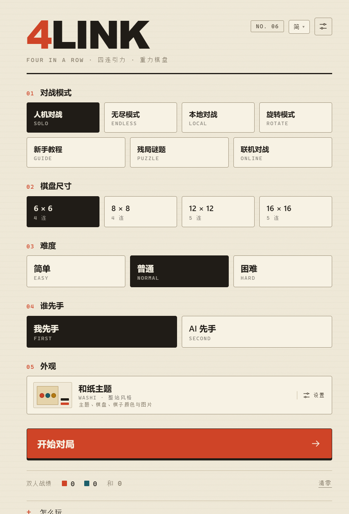
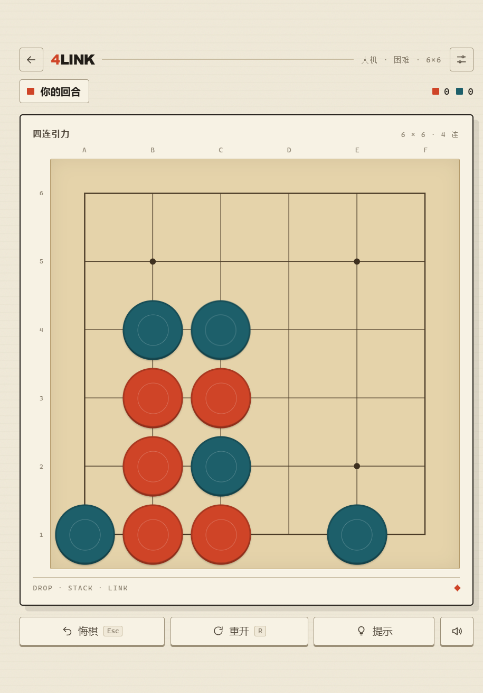
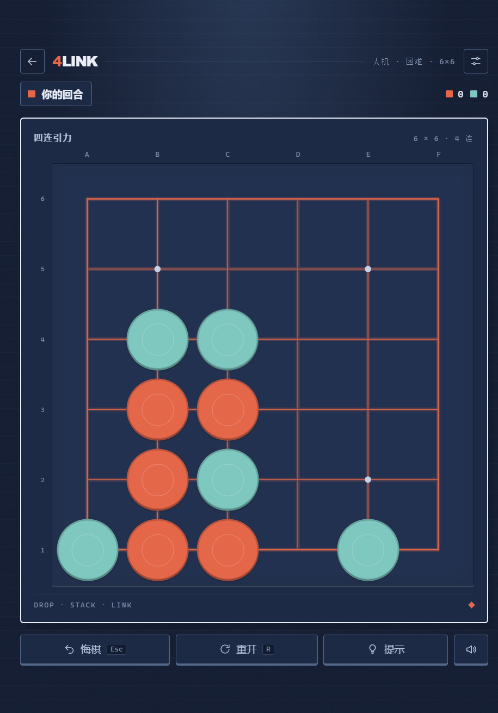
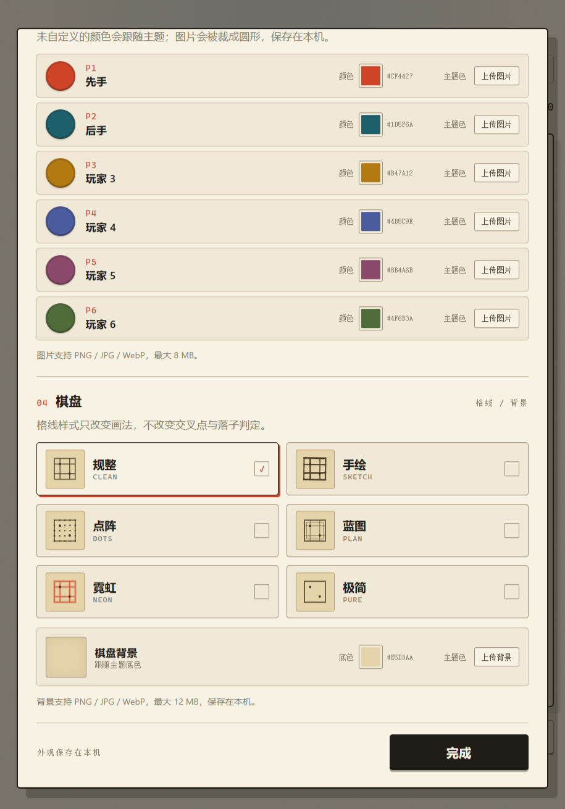
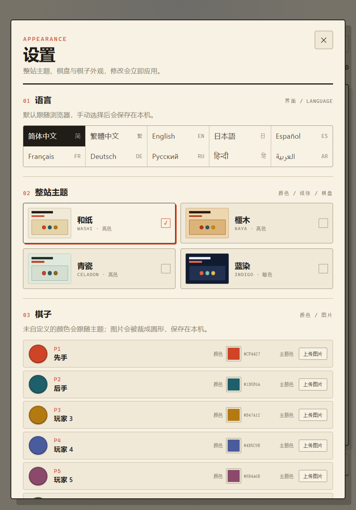

# 4Link

[简体中文](README.md) | **English**

> A gravity-powered four-in-a-row game — **Drop. Stack. Link.**

Pick a column on a square Go-style board and your stone falls to the lowest free intersection. Line up the target number of stones horizontally, vertically or diagonally to win.

<p align="center">
  
  
  
</p>

<p align="center">
  
  
</p>

## Play it

| Platform | Where |
| --- | --- |
| Browser | <https://adlambxd.github.io/4link/> |
| Android | [`4Link-*-android.apk`](https://github.com/AdLambXD/4link/releases/latest) (Android 7.0 / API 24+) |
| Windows | `4Link-*-portable.exe` (no install) or `4Link-*-setup.exe` (NSIS installer) |

All packages bundle the full web build and work completely offline. Only online play needs a network.

## Features

- Four square board sizes — 6×6, 8×8, 12×12, 16×16 — connecting 4 on the small boards, 5 on the large ones
- Local hot-seat play for 2–6 players
- Online 1v1 with room codes or share links: WebRTC peer-to-peer or a WebSocket relay, host-authoritative sync and reconnect
- Three AI levels, searched in a Web Worker with a depth limit that scales with board size
- **Endless mode**: the AI always moves first and attacks; you only defend and score by surviving more moves
- **Rotation mode**: the board turns 90° clockwise after every move, stones re-settle, and lines formed by the rotation count too
- 12 puzzle positions with limited moves and optimal AI defence, plus a 6-lesson interactive tutorial
- Full keyboard play (`1`–`0` drop, `Esc` undo, `R` restart)
- Undo, restart, hints, sound toggle, local scoreboard and saved progress

## Customisation

- **Ten interface languages**: 简体中文, 繁體中文, English, 日本語, Español, Français, Deutsch, Русский, हिन्दी, العربية — auto-detected from the browser and remembered after a manual switch
- **Four site-wide themes**: washi, kaya, celadon and indigo (dark) — paper, ink, controls and board switch together
- **Six board grid styles**: clean, sketch, dots, blueprint, neon and pure. They only change how the grid is drawn — never the intersections or the rules
- Per-player stone colours and images for up to six players, plus custom board backgrounds with a veil slider
- Imported images are cropped, compressed and stored locally; nothing is uploaded

## Development

Requires Node.js **22.12+** (Vite 8 / Vitest 5; 24 LTS recommended).

```bash
npm install
npm run dev        # dev server
npm run build      # type-check + production build
npm test           # rules, AI, puzzles, tutorial, appearance and i18n tests
npm run electron:build  # Windows portable + NSIS installer
npm run cap:sync        # build and sync to the Android project
```

One-command launch scripts: `start-windows.bat` (Windows) and `start-linux.sh` (Linux/macOS).

## How it is built

React + TypeScript + Vite. The rules engine (`src/game/rules.ts`) is framework-free and shared by the UI, the AI worker and the online host. Themes are plain CSS variables, so adding a theme means pushing one object into `src/skins.ts`. English is the second source language for the i18n dictionaries, with the remaining eight shipped as typed locale files.

CI builds and publishes the web bundle, the Android APK and the Windows executables from one workflow, uploading all three to a GitHub Release.

## More documentation

- [Game design and rules analysis](docs/GAME_DESIGN.md) (Chinese)
- [Signing and release credentials](docs/SIGNING.md)
- [Privacy policy](docs/PRIVACY.md)

## License

MIT

Windows builds are code signed with free code signing provided by [SignPath.io](https://signpath.io/), certificate by the [SignPath Foundation](https://signpath.org/).
